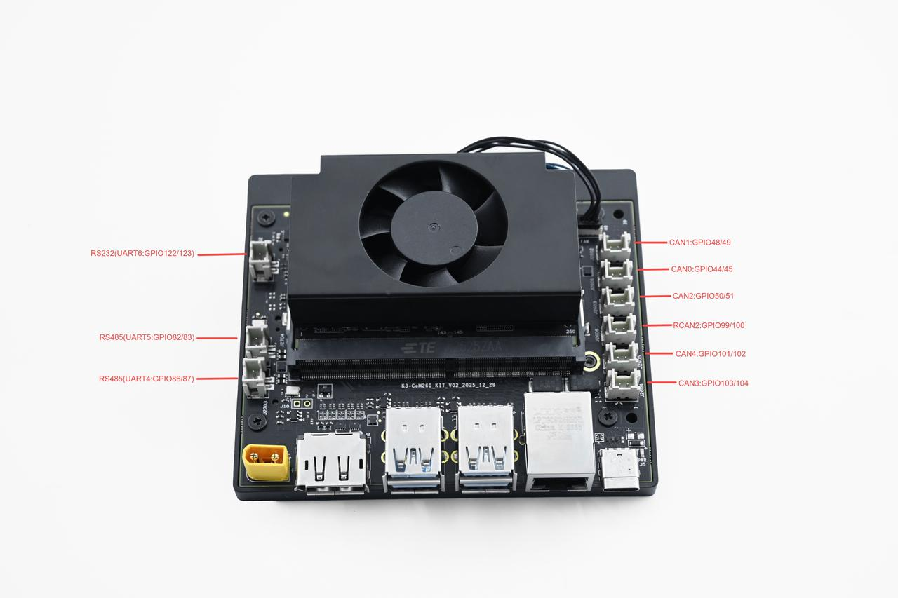

# 01 硬件与环境准备

[返回首页](../README.md) · [下一步：系统烧录](02_系统烧录.md)

## 适用条件



本指南整理自 K3 COM260-KIT、OpenHarmony 6.1 / Linux 6.18.3 的适配记录。

电源为 19 V / 2.37 A。

串口记录使用 CH340 模块、115200 波特率。

连接前依据厂商板卡手册确认接口位置、电平、TX/RX/GND 和 FDL 短接位置；电源断开后接线。

## 电脑端准备

先准备 `picocom`、`unzip`、`file`、`readelf`；涉及应用编译时还需要 CMake、Make 和相应 RISC-V 交叉编译器。

可按需安装：

```sh
sudo apt install picocom unzip file binutils cmake make gcc-riscv64-linux-gnu g++-riscv64-linux-gnu libc6-dev-riscv64-cross
```

HDC、烧录工具和固件见[资源表](10_外部资源与版本说明.md)。

