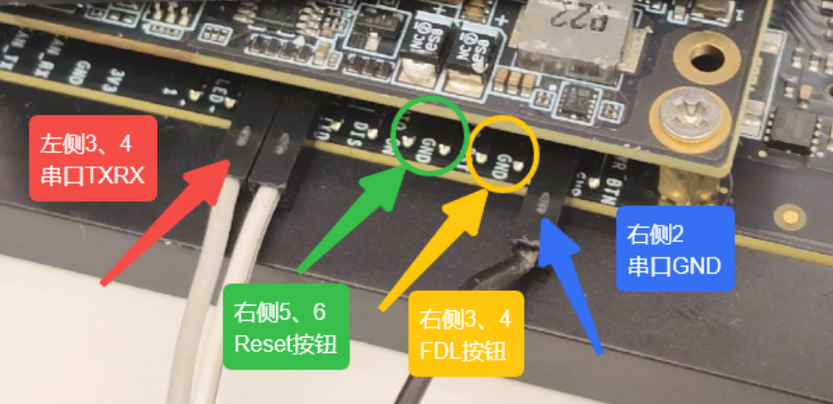

# 02 系统烧录

[返回首页](../README.md) · [下一步：HDC 连接](03_HDC连接与调试.md)

## 所需文件

使用 Linux 烧录工具 `titantools_for_linux-2.2.0-Rc.AppImage` 和固件 `spacemit-k3-oh61-com260-normal-V1.0-20260917.zip`。获取状态见[资源表](10_外部资源与版本说明.md)。

## 操作步骤



1. 断电，按图示短接 FDL 两个引脚。
2. 接通符合板卡要求的电源。
3. 取消 FDL 短接。
4. 用数据线连接板端烧录 Type-C 接口和电脑。
5. 在电脑运行烧录工具，进入“研发工具 → 单机烧录 → 扫描设备”。
6. 确认目标设备，选择对应固件压缩包并烧录，等待工具报告完成。
7. 按工具提示重启，通过串口查看启动日志。

电脑端串口连接示例（替换实际设备节点）：

```sh
picocom -b 115200 /dev/ttyUSB0
```
